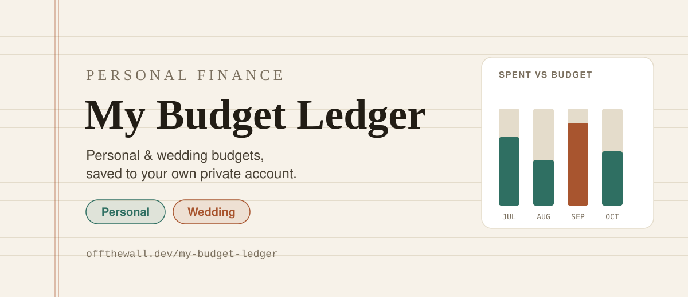

  

<h1 align="center">My Budget Ledger</h1>

  <em>A single-file, no-build budget tracker for personal expenses and a wedding budget. Sign in with Google and it saves to your own private account.</em>

  <a href="https://offthewall.dev/my-budget-ledger/"><strong>Open the live app →</strong></a>

  <a href="#using-the-app">Using the app</a> ·
  <a href="#features">Features</a> ·
  <a href="#how-saving-works">How saving works</a> ·
  <a href="#running-it-locally">Running it locally</a> ·
  <a href="#tech">Tech</a>

---

## Using the app

1. Open the live link above.
2. Click **Sign In with Google**. Google shares only your name, email address and profile picture.
3. Start entering, or bring over your data (below).

Not ready to sign in? **Try with sample data** fills the app with made-up numbers. Nothing in the sample is ever saved.

### Moving over from the Google Drive version

Earlier versions saved a file called `budget-ledger-data.json` to your Google Drive. To move it:

1. Download `budget-ledger-data.json` from your Google Drive.
2. Sign in to the app. The first time, it offers **Bring over my Drive file**.
3. Pick the file and confirm. Everything comes across (budgets, expenses, income, subscriptions, salary setup, vendors and savings goals) and saves to your account.

The Drive file isn't changed or deleted; remove it yourself once you're happy.

## Features

- **Two trackers**: a personal monthly budget and a separate wedding budget, each with their own categories, subcategories, and history.
- **Dashboard**: spend-vs-budget by category, monthly trend chart, cash flow chart (income vs. expenses), and a monthly breakdown of where money went.
- **Expense & income log**: searchable/filterable transaction log with date, amount, category, and payment-method filters.
- **Payment methods & bank accounts**: track which card or account each transaction used, with running totals per account/card.
- **Subscriptions**: recurring expenses with billing cycles, tracked separately from one-off purchases.
- **Recurring income & salary tooling**: model paychecks (weekly/biweekly/semi-monthly/monthly) with pretax/tax deductions and see a net-pay breakdown.
- **Savings goals**: set targets and track progress toward them.
- **Vendors** (wedding tracker): tag expenses to vendors and see per-vendor totals.
- **Bulk import from Excel**: download an `.xlsx` template (with a Lists tab of your categories, cards, accounts, and vendors), fill it in, and upload it back. Every row is previewed with warnings and duplicate detection before anything is added.
- **CSV/JSON export & import**: export a full backup any time, or restore from one.
- **Light/dark theme toggle** and a share button for sending the app link to others.

## How saving works

- Sign-in is shared by every app on [offthewall.dev](https://offthewall.dev), through [Supabase](https://supabase.com/) Auth with Google (`/shared/auth.js` in the site repo).
- Each person's ledger is one row in a Supabase (Postgres) table, stored in the same JSON shape as the app's full backup. Row-level security means only its owner can read or change it.
- Every save says which version it started from. If the ledger changed in another tab or on another device, the save is refused and the page asks you to reload, so nothing is silently overwritten.
- Earlier versions are kept automatically (at most one every 30 minutes, the newest 50), and the whole database is backed up nightly.
- **Manage → Your data → Delete my saved budget** removes your ledger from the server.

The table, its security rules and their tests live in the site owner's private database repo.

## Running it locally

This is a static single HTML file with no build step. It loads the shared sign-in from the main site (`/shared/vendor/` and `/shared/auth.js`), so run it alongside the [site repo](https://github.com/billywall732/billywall732.github.io) with this folder served at `/my-budget-ledger/`. On its own, everything except sign-in works, including the sample data.

Sign-in works locally on `http://localhost:8123`, which is on the Supabase project's list of allowed addresses.

## Tech

Plain HTML/CSS/JavaScript in a single file (`index.html`), no framework, no build tooling. Deployed via GitHub Pages.

| Piece | Used for |
|---|---|
| Supabase (Auth + Postgres) | Sign-in with Google, and saving each person's ledger privately |
| IndexedDB + localStorage | Working offline and remembering settings in the browser |
| SheetJS (loaded on demand) | The Excel import template and bulk import |
| Hand-drawn SVG | Every chart, with no chart library |
| Web Share API | The share button |
| GitHub Pages + Cloudflare | Hosting at https://offthewall.dev/my-budget-ledger/, with security headers |

**Home-screen icon:** `app-icon.svg` (a gold coin) is the source for `icon-180.png` (iPhone) and `icon-192.png` / `icon-512.png` (Android, listed in `manifest.webmanifest`). The PNGs are screenshots of the SVG at those sizes; remake them after changing it. It matches the other Off the Wall app icons: one object on a dark glow in the app's color, with two white swooshes.

Ideas for what's next are tracked in [GitHub Issues](https://github.com/billywall732/my-budget-ledger/issues).

## License

[MIT](LICENSE)
